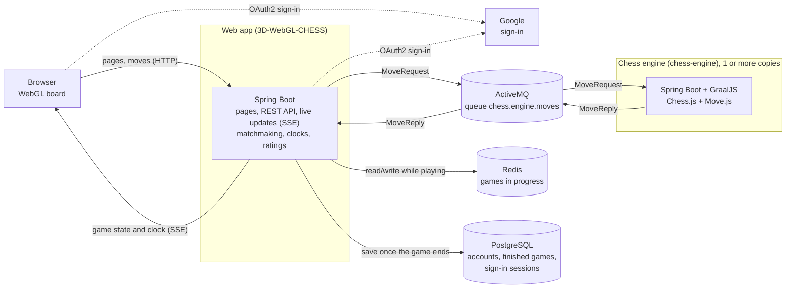
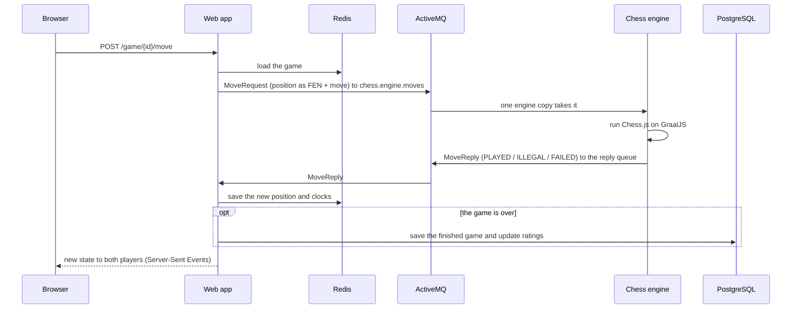

[Link to hosted version](https://chess.jblazing.com)

This was developed for a computer graphics class back in the fall of 2018.

Originally all logic was done in browser using Chess.js and WebGL, and everything was served statically.
In an effort to add features that I originally wanted for the project such as online play and match making,
I added a Spring Boot backend and moved the game logic to the server.
Since the chess engine is JavaScript based, it runs Chess.js on GraalVM (GraalJS).

The site now has Google sign-in, online matchmaking by rating, games against the computer, 5+3 blitz clocks,
Elo ratings and a game history.

Currently, the "AI" uses the random chicken method for choosing its next move.

When it is your turn you can use the A and D keys to cycle through all legal moves and then press enter to make that move.


## Architecture

The game is split into two services that talk over ActiveMQ:

- **Web app** (`3D-WebGL-CHESS`): serves the pages and the 3D board, handles sign-in, matchmaking, clocks
  and ratings, and keeps track of every game.
- **Chess engine** (`chess-engine`): plays moves. It takes move requests off a queue, runs them through
  Chess.js on GraalJS and sends back the result. It has no web server and keeps no state, so you can run
  as many copies as you like and they share the queue.



### Playing a move



- The web app waits up to 10 seconds for the engine (`game.chess.engine.timeout`). If no engine answers,
  the player gets HTTP 503 and can try again.
- Computer moves go the same way, with no move in the request, so the engine picks one.
- Move messages aren't persisted and expire, so a request nobody picked up in time is dropped rather than
  played late.

### Where the data lives

| Data                              | Stored in  | Notes                                                                                     |
|-----------------------------------|------------|-------------------------------------------------------------------------------------------|
| Games in progress                 | Redis      | Kept until the game ends; Redis needs persistence (AOF) so games survive a restart        |
| Finished games                    | PostgreSQL | Written once when the game ends; also kept in Redis for 10 minutes (`game.state.cache.duration`) |
| Accounts and ratings              | PostgreSQL | Schema created by Liquibase                                                               |
| Sign-in sessions                  | PostgreSQL | Spring Session; you stay signed in for 30 days                                            |

The history page merges games from Redis and PostgreSQL, so games in progress show up there too.

## Project layout

A Maven multi-module build (root `pom.xml`, Java 25, Spring Boot 3.5):

| Module             | What it is                                                                                         |
|--------------------|----------------------------------------------------------------------------------------------------|
| `chess-engine-api` | The messages the two services exchange (`MoveRequest`, `MoveReply`, `EngineProtocol`), the shared `Move`/`Result` models, and `Chess.js`, which the web app also serves to the browser |
| `chess-engine`     | The engine service (`com.jblazing.engine`)                                                        |
| `3D-WebGL-CHESS`   | The web app (`com.jblazing`)                                                                       |

## Running locally

You need:

- JDK 25. For the engine, use **GraalVM CE of the same release as `graaljs.version`** in the root `pom.xml`
  (currently GraalVM CE 25.0.4.1 / 25.4.4.1.1). On any other JDK, GraalJS still works but interprets the
  JavaScript, and every move is much slower. The engine's startup log tells you which one you got:
  `Chess engine warmed up in … ms on the GraalVM CE runtime` (good) or `… on the Interpreted runtime` (slow).
- PostgreSQL, Redis and ActiveMQ. For example, with Podman or Docker:

  ```sh
  podman run -d --name postgres -p 5432:5432 -e POSTGRES_DB=chess -e POSTGRES_USER=chess -e POSTGRES_PASSWORD=chess postgres:18.6
  podman run -d --name redis -p 6379:6379 -v redis-data:/data redis:8.10.2 redis-server --appendonly yes --requirepass changeme
  podman run -d --name activemq -p 61616:61616 -p 8161:8161 -e ACTIVEMQ_CONNECTION_PASSWORD=<password> apache/activemq-classic:6.2.0
  ```

- A Google OAuth client for sign-in, with `http://localhost:8080/login/oauth2/code/google` as an authorized
  redirect URI. Its settings go in `3D-WebGL-CHESS/src/main/resources/application-Auth.properties`, which
  is not in git:

  ```properties
  spring.security.oauth2.client.registration.google.client-id=${GOOGLE_CLIENT_ID}
  spring.security.oauth2.client.registration.google.client-secret=${GOOGLE_CLIENT_SECRET}
  spring.security.oauth2.client.registration.google.scope=openid,profile,email
  ```

  To run without Google sign-in, start the web app with `--spring.profiles.active=noauth`; each browser
  session then plays as a guest.

Both services read their settings from environment variables; the defaults match the local setup above.

| Variable                                         | Used by           | Default                                   |
|--------------------------------------------------|-------------------|-------------------------------------------|
| `ACTIVEMQ_URL`                                   | web app, engine   | `tcp://localhost:61616`                   |
| `ACTIVEMQ_USER` / `ACTIVEMQ_PASSWORD`            | web app, engine   | `admin` / empty                           |
| `DB_URL` / `DB_USERNAME` / `DB_PASSWORD`         | web app           | `jdbc:postgresql://localhost:5432/chess` / `chess` / `chess` |
| `REDIS_HOST` / `REDIS_PORT` / `REDIS_PASSWORD`   | web app           | `localhost` / `6379` / `changeme`         |
| `GOOGLE_CLIENT_ID` / `GOOGLE_CLIENT_SECRET`      | web app           | none                                      |
| `SESSION_COOKIE_SECURE`                          | web app           | `false` (set `true` behind HTTPS)         |

On a server, the web app also reads `/etc/jblazing/chess.properties` if it exists.

Start the engine (`com.jblazing.engine.ChessEngineApplication`) and the web app (`com.jblazing.MyApplication`)
in either order, then open http://localhost:8080. The web app waits for the engine, so moves fail with
HTTP 503 only while no engine is running.

> **Containers in WSL on Windows:** WSL may forward ports to Windows only on IPv6 (`[::1]`), so `localhost`
> connections from Java are refused. Use `DB_URL=jdbc:postgresql://[::1]:5432/chess`, `REDIS_HOST=::1` and
> `ACTIVEMQ_URL=tcp://[::1]:61616`, plus the JVM option `-Djava.net.preferIPv6Addresses=true`.

## Building

```sh
mvn package
```

This builds both services and a container image for each:

- **Chess engine:** `chess-engine:0.0.1-SNAPSHOT`, built from `chess-engine/Dockerfile` with the `docker`
  command. It runs on a GraalVM CE cut down with `jlink` to just the modules the engine needs (about 280 MB),
  so GraalJS compiles the JavaScript. The GraalVM release comes from `graalvm.release` and `graalvm.archive`
  in the root `pom.xml`; **change them together with `graaljs.version`**. If you add a library that needs
  another Java module, add it to the `jlink` list in the Dockerfile.
- **Web app:** built with Spring Boot's buildpacks (Paketo).

The image builds need a Docker or Podman API. With rootless Podman, point `DOCKER_HOST` at its socket
(e.g. `DOCKER_HOST=unix:///run/user/1000/podman/podman.sock`). To build without images:

```sh
mvn package -Ddocker.image.skip=true -Dspring-boot.build-image.skip=true
```

Run the engine image with the broker settings:

```sh
podman run -d --name chess-engine -e ACTIVEMQ_URL=tcp://<broker-host>:61616 -e ACTIVEMQ_PASSWORD=<password> chess-engine:0.0.1-SNAPSHOT
```

## Tests

```sh
mvn test
```

- The engine's tests use an ActiveMQ broker inside the test JVM, so they need nothing else.
- The web app's tests run a real engine and an in-JVM broker, an embedded PostgreSQL, and Redis in a
  container through Testcontainers, so they need Docker or Podman.
